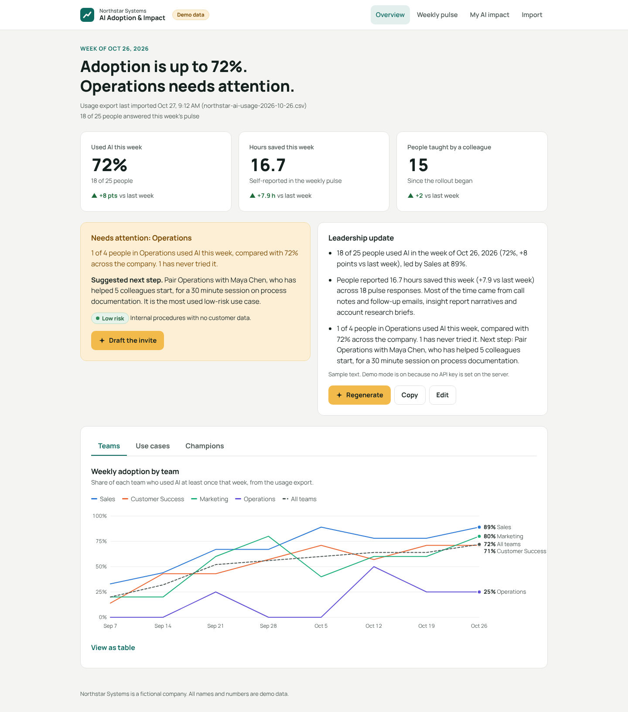
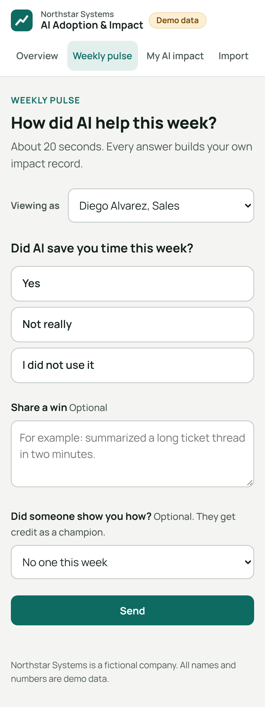
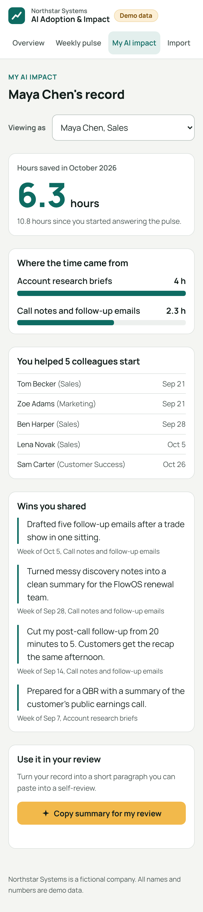
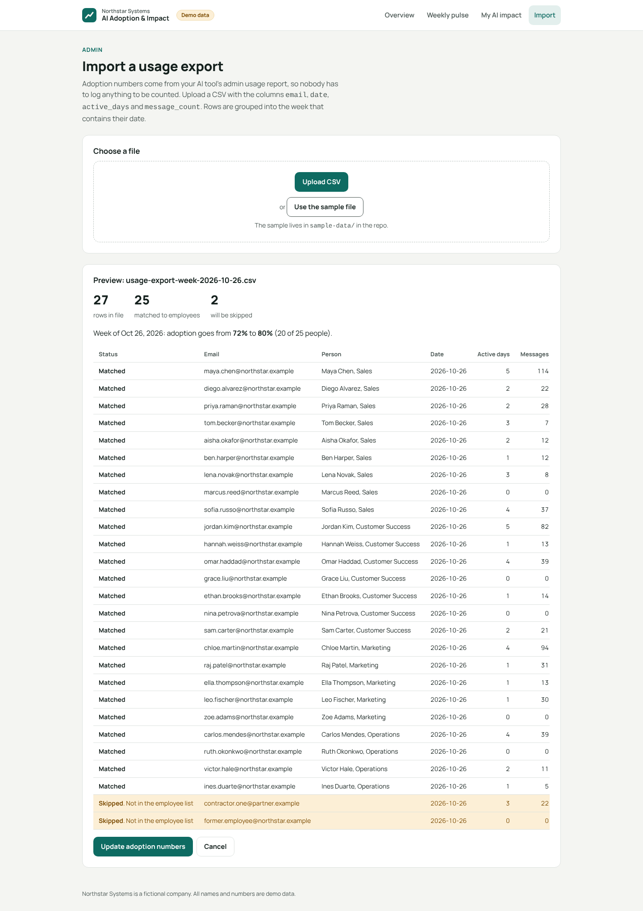

# AI Adoption & Impact Tracker

A web app for **Northstar Systems** (a fictional company with three products: FlowOS, Connect and Insight) that shows an AI enablement lead whether an AI rollout is working, while giving every employee a reason to participate.

> All people, emails and numbers in this repo are fictional demo data.

## The problem

Most AI rollouts are measured with license counts or with self-reported tracking. License counts say nothing about value. Self-reported tracking usually fails because logging is a chore that benefits someone else: people stop filling in the spreadsheet after week two, and the data that remains is skewed toward enthusiasts.

The enablement lead is left without a clear answer to the two questions leadership asks every week: are people using it, and is it worth it?

## Design principle

This app avoids the logging trap in two ways:

1. **Adoption data comes from an imported usage export.** Who used AI, and how often, comes straight from the AI tool's admin usage report. Nobody logs anything to be counted.
2. **Impact data comes from a 20-second weekly pulse, and every answer pays the employee back.** Time saved and wins build the employee's own "My AI impact" record, which they can turn into a review-ready paragraph for their performance review.

Colleagues who help others get started are credited as champions by the people they helped, so peer teaching becomes visible too.

## Screens

| Screen | Who it is for | What it does |
| --- | --- | --- |
| Overview | Enablement lead | This week's answer as a headline, three numbers, the team that needs attention (with an AI-drafted invite), and an AI-written leadership update. Tabs for Teams, Use cases (with risk tags) and Champions. |
| Weekly pulse | Every employee | Did AI save you time? Roughly how much? Optional win and "Did someone show you how?" |
| My AI impact | Every employee | Hours saved this month, where the time came from, colleagues helped, wins in your own words, and "Copy summary for my review". |
| Import | Admin | Upload a usage export CSV, preview matches and skipped rows, see the projected adoption change, then update the numbers. |

Works on any screen, so people can answer the pulse from Slack on a phone or a laptop in about 20 seconds.

### Screenshots

All screenshots were taken in demo mode with the fictional seed data.

**Overview** (desktop)



**Weekly pulse** and **My AI impact** (phone)

<p>
  
  
</p>

**Import preview**



## Run it locally

Requires Node.js 20 or newer.

```bash
npm install
```

```bash
npm run dev
```

Then open http://localhost:5173. The API runs on port 3001 and the database is created and seeded with demo data on first start.

No API key is needed. Without one, the app runs in **demo mode**: the AI features (invite draft, leadership update, review summary) return realistic sample text built from the real numbers, marked "Sample text" in the UI.

### Turning on live AI

```bash
cp .env.example .env
```

Set `ANTHROPIC_API_KEY` in `.env` and restart. The key is read by the Express server only and is never sent to the browser. `CLAUDE_MODEL` is optional.

### Other commands

```bash
npm run seed
```

Resets the demo database to its original state.

```bash
npm start
```

Builds the client and serves the whole app from Express on http://localhost:3001.

## Deploying to Google Cloud Run

The repo includes a `Dockerfile` that builds the client and serves everything from the Express server on the port Cloud Run provides in `PORT`. The app runs in demo mode with no API key. See [DEPLOY.md](DEPLOY.md) for beginner-friendly, copy-paste steps from Google Cloud Shell.

### Known demo limitation: data resets

The app keeps using SQLite, stored inside the container. Cloud Run containers do not have permanent disk, so every time a new instance starts (after a deploy, after the service scales to zero and wakes up, or when Cloud Run adds an instance) the database is created again and reseeded with the demo data. Pulse answers and imports made on the live site disappear at that point, and two instances running at once can show different data. That is fine for a demo. A real deployment would move the data to a managed database such as Cloud SQL.

## Importing usage data

The Import screen accepts a CSV shaped like an admin usage report:

```csv
email,date,active_days,message_count
maya.chen@northstar.example,2026-10-26,5,114
```

Each row is assigned to the week (Monday start) that contains its date. Rows whose email is not in the employee list are shown and skipped. A sample lives in [`sample-data/usage-export-week-2026-10-26.csv`](sample-data/usage-export-week-2026-10-26.csv); click "Use the sample file" on the Import screen to try it.

## Stack

- React + Vite frontend
- Node + Express backend
- SQLite (`better-sqlite3`)
- Claude API, called from the backend only

See [CLAUDE.md](CLAUDE.md) for project conventions.

## Informed by

- Duke Center for Computational Thinking, AI adoption framework (video): [link to be added](https://example.com/duke-cct-ai-adoption-framework)
